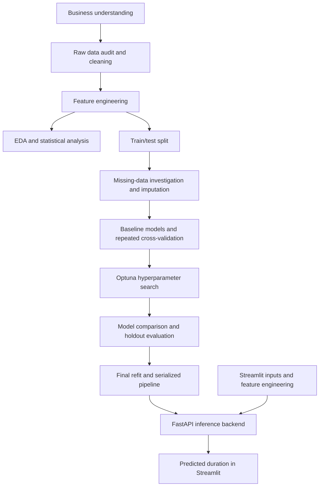

# 🛵 Swiggy Delivery Time Prediction

### From raw delivery data to an interactive machine learning web application

An end-to-end **regression and deployment portfolio project** that estimates food-delivery duration (in minutes) from rider attributes, order information, geographic distance, traffic, weather, and time-related features.

The repository documents the complete data-science workflow: **business understanding → data cleaning and feature engineering → exploratory data analysis → missing-data investigation and imputation → baseline benchmarking → hyperparameter tuning → final model evaluation → Streamlit + FastAPI application → Docker deployment configuration**.

> **Project context:** An independent educational/portfolio project using a Swiggy-themed delivery dataset. It is **not affiliated with Swiggy**, and its estimates are not official, live Swiggy ETAs. The published model is trained on historical data; this repository does not claim to ingest live traffic or weather feeds.

**Repository:** [swiggy-delivery-time-prediction](https://github.com/alwaysrajeev7/swiggy-delivery-time-prediction)

<!-- Add an actual deployment URL or a screenshot here once verified. -->

## 📌 At a glance

| Item | Details |
|---|---|
| Problem | Supervised regression: predict delivery duration in minutes |
| Raw dataset | 45,593 rows and 20 columns (as documented in the cleaning workflow) |
| Final modeling dataset | 45,501 records; 24 predictor features + target |
| Train / test | 36,401 / 9,100 records |
| Selected estimator | Tuned `GradientBoostingRegressor` (scikit-learn) |
| Holdout **test MAE** | **3.2 minutes** (rounded, notebook result) |
| Holdout **test R²** | **0.81** (rounded, notebook result) |
| Application | Streamlit frontend + FastAPI inference backend |
| Packaging | Separate Dockerfiles; Docker Compose |
| Deployment configuration | `Dockerfile.render` for Render-oriented setup; availability of a live deployment is not asserted here |

**Metric interpretation:** The holdout scores above were obtained **before** the final estimator was refitted on the combined training and test data. They are not independent test scores for the final full-data exported pickle artifact.

## 🎯 Business problem

Food delivery times vary with conditions such as trip distance, congestion, weather, order timing, and delivery-partner attributes. A data-informed duration estimate can help set realistic expectations and motivate investigation of operational bottlenecks.

**Objective:** Learn a mapping from historical order and delivery conditions to the target `time_taken` in minutes, evaluate predictive accuracy on held-out records, and expose the trained model through a user-friendly web application.

The repository investigates **associations and predictions**, not verified causal effects or realized business improvements. Operational impacts such as reduced cancellations or improved retention are potential use cases, not measured outcomes of this project.

## 🧭 End-to-end workflow



### 1. Data quality, cleaning and feature engineering

**Notebook:** [`1. Data Quality Investigation, Cleaning & Feature Engineering.ipynb`](3.%20ML%20Notebooks/1.%20Data%20Quality%20Investigation%2C%20Cleaning%20%26%20Feature%20Engineering.ipynb)

- Inspected types, suspicious string representations of missing data, null patterns, duplicates and feature distributions.
- Standardized rider, order, vehicle, traffic, weather and festival fields, and investigated invalid geospatial coordinates.
- Computed restaurant-to-customer **Haversine (straight-line) distance** in kilometers from coordinates. This is **not** road-network distance.
- Combined `order_date`, `order_time`, and `order_picked_time` into timestamps, accounting for the assumed case where pickup occurs just after midnight.
- Engineered pickup duration, hour-of-day, sine/cosine encoding, time-of-day buckets, lunch/dinner rush flags, day/week/month information and calendar indicators.
- Kept 45,501 records after cleaning and created a roughly 80:20 train/test split.

> The historical cleaning function also handles partially missing order timestamps. The web application instead expects a valid user-supplied scenario and uses an **inference-specific** version of the feature engineering. Only the 24 model predictors should enter the saved preprocessing pipeline.

### 2. Exploratory data analysis and statistical insights

**Notebook:** [`2. What Influences Delivery Time Exploratory Data Analysis & Statistical Insights.ipynb`](3.%20ML%20Notebooks/2.%20What%20Influences%20Delivery%20Time%20Exploratory%20Data%20Analysis%20%26%20Statistical%20Insights.ipynb)

The EDA combines univariate distributions, bivariate comparisons, multivariable checks, correlation measures, hypothesis tests and outlier investigation. Main themes:

- **Distance:** Both Pearson and Spearman analyses indicate a positive relationship with delivery duration.
- **Traffic:** Delivery-time distributions differ among `Low`, `Medium`, `High` and `Jam`; analysis also considers the interplay between traffic and distance.
- **Multiple deliveries:** The notebook reports a **Spearman correlation of about 0.34**, suggesting a moderate monotonic association with delivery duration.
- **Rider characteristics:** Age has an approximately **0.30 Pearson / 0.31 Spearman** relationship with duration in the analyzed data; the notebook explicitly investigates possible confounding rather than assuming causation.
- **Weather and festivals:** Delivery patterns vary across conditions. The festival group is small (around **1.97%** of records in the EDA), so group comparisons warrant caution.
- **Order timing:** Hour, time-of-day, weekend, month and pickup duration are examined, including cases with weak or limited relationships.

**Interpretation:** Statistical significance, predictive association and causality are different concepts. Observational effects are not necessarily the result of intervening on one input.

### 3. Missing-data mechanisms and imputation

**Notebook:** [`3. Investigating Missing Data Mechanisms & Evidence-Based Imputation.ipynb`](3.%20ML%20Notebooks/3.%20Investigating%20Missing%20Data%20Mechanisms%20%26%20Evidence-Based%20Imputation.ipynb)

- Explored missingness using nullity charts, heatmaps, a dendrogram and missingness-related analyses.
- Identified strong **block-wise co-missingness**; for example, the notebook reports approximately **0.99** nullity correlation between `rider_age` and `rider_ratings`.
- Investigated evidence consistent with missing-at-random patterns, while correctly noting that such diagnostics **cannot prove** MCAR, MAR or MNAR.
- Compared imputation approaches and selected a strategy using **distance-weighted `KNNImputer(n_neighbors=3)` for designated numeric fields**, with **most-frequent imputation** for certain categorical and Boolean fields.
- Fitted imputation on training data and transformed the held-out test data, then exported imputed train and test CSVs.
- Compared model performance using imputed records against complete-case analysis.

**Methodological caveat:** The imputed training dataset was materialized **before** later repeated cross-validation. Consequently, imputation fitted using the full training partition can allow information from a CV validation fold to influence training-fold representations. A stricter future experiment would place imputation **inside each CV pipeline**. The final holdout test was handled separately in the notebook's imputation workflow; these two evaluation issues should not be conflated.

### 4. Baseline benchmarking and bias–variance analysis

**Notebook:** [`4. Baseline Model Benchmarking, Cross-Validation & Bias–Variance Analysis.ipynb`](3.%20ML%20Notebooks/4.%20Baseline%20Model%20Benchmarking%2C%20Cross-Validation%20%26%20Bias%E2%80%93Variance%20Analysis.ipynb)

Compared eight regression approaches:

- Linear Regression
- K-Nearest Neighbors
- Decision Tree
- Random Forest
- Extra Trees
- Gradient Boosting
- Histogram-based Gradient Boosting
- XGBoost

Used separate preprocessing configurations appropriate to tree-based versus linear/distance-based models. Categorical variables were encoded with **one-hot encoding** for nominal features and **ordinal encoding** for the ordered traffic categories. Results were evaluated using repeated cross-validation, MAE, R², and train–validation gaps, alongside bootstrap-based bias–variance experiments.

Selected **baseline cross-validation** results recorded in the notebook:

| Baseline model | CV validation MAE (min) | CV validation R² |
|---|---:|---:|
| HistGradientBoosting | 3.2811 | 0.8026 |
| Random Forest | 3.2927 | 0.7983 |
| XGBoost | 3.3190 | 0.7996 |
| Extra Trees | 3.3290 | 0.7936 |
| Gradient Boosting | 3.7407 | 0.7476 |
| Linear Regression | See exported baseline results | 0.5711 |

The analysis shows why very low training error alone does not imply good generalization (notably for unconstrained trees).

### 5. Hyperparameter optimization, comparison and model selection

**Notebook:** [`5. Hyperparameter Optimization, Model Selection & Final Performance Evaluation.ipynb`](3.%20ML%20Notebooks/5.%20Hyperparameter%20Optimization%2C%20Model%20Selection%20%26%20Final%20Performance%20Evaluation.ipynb)

Used **Optuna** to tune XGBoost, Random Forest, Extra Trees, Histogram-based Gradient Boosting and Gradient Boosting. Candidate models were compared using repeated cross-validation and resampling-based bias–variance diagnostics.

| Tuned model | CV validation MAE (min) | CV validation R² |
|---|---:|---:|
| XGBoost | **3.2084** | 0.8112 |
| **Gradient Boosting (selected)** | **3.2146** | **0.8112** |
| Random Forest | 3.2192 | 0.8095 |
| Extra Trees | 3.2366 | 0.8077 |
| HistGradientBoosting | 3.2385 | 0.8084 |

**Why Gradient Boosting?** The notebook explicitly acknowledges that **XGBoost had a marginally lower CV MAE**. Gradient Boosting was selected after weighing the near-identical CV scores against the estimated squared-bias and variance results from the project's bootstrap analysis (including lower estimated prediction variance for Gradient Boosting under that procedure). This is a documented trade-off, **not** a claim that Gradient Boosting wins every metric.

Selected `GradientBoostingRegressor` settings include `n_estimators=650`, `learning_rate≈0.01117`, `max_depth=8`, `min_samples_split=10`, `min_samples_leaf=3`, `max_features=0.5`, `subsample≈0.9715` and `random_state=42`.

#### Holdout evaluation

| Metric | Train | Test |
|---|---:|---:|
| MAE (minutes) | 2.9 | **3.2** |
| R² | 0.85 | **0.81** |

The notebook then **refits the selected preprocessing + Gradient Boosting pipeline on the combined 45,501 records** and exports it as `gbr_model_version_1.pkl`. A subsequent fit-set check reports an approximately **3-minute MAE and 0.85 R²**, which is **not** an unseen-test evaluation.

## 🧠 Model features

The saved model expects **24 engineered predictors**, grouped below. The target `time_taken` is **not** an input.

| Group | Predictors |
|---|---|
| Rider and delivery operations | `rider_age`, `rider_ratings`, `multiple_deliveries`, `vehicle_type`, `vehicle_condition` |
| Order and location | `distance_km`, `order_type`, `order_pickup_time_mins` |
| Time-of-day | `order_placed_hr`, `sin_hr`, `cos_hr`, `order_time_of_day`, `is_lunch_rush`, `is_dinner_rush` |
| Calendar | `order_day`, `order_day_of_week`, `is_friday_night`, `is_weekend`, `order_month`, `is_month_start`, `is_month_end` |
| Context | `is_festival`, `weather`, `traffic` |

The trained `Pipeline` includes the fitted categorical preprocessing and Gradient Boosting estimator. **Date/time construction, distance calculation and derived-feature engineering happen before this saved pipeline.** This separation is important when serving predictions through the web app.

## 🌐 Web application and inference flow

The web application uses **Streamlit** for collecting order information and displaying a prediction, and **FastAPI** as the inference service.


**Key source files:**

- `5. Website/frontend/frontend.py` — page layout, input form, request handling and result display.
- `5. Website/frontend/feature_engineering.py` — derives the feature schema from user-friendly raw inputs.
- `5. Website/backend/api_code/main.py` — FastAPI HTTP endpoints (`/`, `/health`, `/predict` in the shared backend design).
- `5. Website/backend/schema/data_validation.py` — Pydantic constraints for model inputs.
- `5. Website/backend/ml_model/model_prediction.py` — model loading and inference.
- `5. Website/backend/ml_model/gbr_model_version_1.pkl` — trained model pipeline artifact.

**Important:** Model inference relies on the trained preprocessing artifact receiving **exactly the expected feature names and compatible encodings**. Ensure the inference helper's datetime rules and the Pydantic schema remain aligned with the notebook. A functioning public endpoint has not been verified as part of preparing this README.

## 📁 Repository organization

```text
swiggy-delivery-time-prediction/
├── 1. Business Overview/
│   └── Business Understanding & Project Overview.docx
├── 2. Datasets/
│   ├── 1. Uncleaned Data/
│   ├── 2. Clean but Non-Imputed data/
│   └── 3. Clean & Imputed Data/
├── 3. ML Notebooks/
│   ├── 1. Data Quality Investigation, Cleaning & Feature Engineering.ipynb
│   ├── 2. What Influences Delivery Time Exploratory Data Analysis & Statistical Insights.ipynb
│   ├── 3. Investigating Missing Data Mechanisms & Evidence-Based Imputation.ipynb
│   ├── 4. Baseline Model Benchmarking, Cross-Validation & Bias–Variance Analysis.ipynb
│   └── 5. Hyperparameter Optimization, Model Selection & Final Performance Evaluation.ipynb
├── 4. Model Results/
│   ├── 1. Models Result/
│   ├── 2. Pre-processing Pipelines/
│   └── 3. Final Model/
├── 5. Website/
│   ├── backend/
│   │   ├── api_code/
│   │   ├── ml_model/
│   │   ├── schema/
│   │   ├── Dockerfile
│   │   └── requirements.txt
│   ├── frontend/
│   │   ├── frontend.py
│   │   ├── feature_engineering.py
│   │   ├── Dockerfile
│   │   └── requirements.txt
│   ├── .dockerignore
│   ├── docker-compose.yml
│   └── Dockerfile.render
├── .gitignore
└── README.md
```

## ▶️ Run locally

**Requirements:** Python (use a compatible version for the serialized scikit-learn pipeline), `pip`, and the two supplied `requirements.txt` files. For the Docker route, install Docker with Compose.

### Option A: Run Python services from the repository

From the repository root, in **PowerShell**:

```powershell
cd '5. Website'
python -m venv myenv
.\myenv\Scripts\Activate.ps1
pip install -r backend/requirements.txt
pip install -r frontend/requirements.txt
```

Start the backend in the first terminal, from `5. Website`:

```powershell
python -m uvicorn backend.api_code.main:app --host 127.0.0.1 --port 8000
```

Open a **second** terminal, activate the same environment if needed, and run from `5. Website`:

```powershell
python -m streamlit run frontend/frontend.py
```

- Streamlit: <http://localhost:8501>
- FastAPI health: <http://localhost:8000/health>
- FastAPI interactive docs: <http://localhost:8000/docs>

> The commands above assume the frontend uses a local API URL such as `http://127.0.0.1:8000/predict` (or an equivalent environment-configured URL), and that the included dependencies are compatible with the pickle. Inspect the current source files if your local configuration differs.

### Option B: Docker Compose

From the `5. Website` directory:

```bash
docker compose up --build
```

The repository has **separate backend and frontend Dockerfiles** plus a Compose configuration. Confirm the actual published host ports in `docker-compose.yml`; the common development defaults are `8000` for FastAPI and `8501` for Streamlit. Container-to-container API calls must use the Compose backend **service name**, not `localhost` from inside the frontend container.

Stop services with:

```bash
docker compose down
```

### Render deployment

The repository includes `5. Website/Dockerfile.render`, indicating a Render-oriented container deployment setup. The exact Render service type, environment variables, build context and public URL should be documented **after verification in the Render dashboard**. Do not treat the existence of this Dockerfile as proof of a running public deployment.

## 🧪 Reproducibility and constraints

- The notebooks were developed in a Colab-style research workflow; some cells reference `/content/...` paths and require path updates to run unchanged elsewhere.
- The serialized `.pkl` artifact is trusted project code/data only; **do not unpickle untrusted files**. Match scikit-learn and Python dependency versions when loading it.
- The two preprocessing stages are different: **historical missing-value imputation** during dataset preparation and **fitted model preprocessing** inside the exported prediction pipeline.
- The final model was trained after the data had already been imputed; the exported pipeline does **not** include the historical KNN imputation stage.
- Data coverage, including limited historical time periods and rare categories, restricts how confidently the model can generalize to new operating conditions.
- No calibrated prediction intervals, probability/confidence percentages, live traffic, map-based road-route inference, or continuous retraining are claimed.
- The README reports **recorded notebook outputs**, not a newly executed reproducibility run or live production benchmark.

## 🛠 Technology stack

| Layer | Technology |
|---|---|
| Analysis | Python, pandas, NumPy, Jupyter / Google Colab |
| Statistics and visualization | SciPy/statistical tests; notebook-based plotting libraries |
| ML | scikit-learn, XGBoost |
| Search | Optuna |
| Frontend | Streamlit |
| API | FastAPI, Pydantic |
| Serialization | Python pickle (`.pkl`) |
| Containerization | Docker, Docker Compose |
| Deployment configuration | Render-oriented Dockerfile |
| Version control | Git, GitHub |

## 📈 Possible next improvements

- Add saved, representative screenshots and a verified live demo link.
- Add a small automated check that compares feature engineering and a saved model prediction with a known notebook example.
- Evaluate imputation **within each cross-validation fold** to reduce possible validation leakage.
- Re-evaluate on a truly independent, newer holdout dataset to assess drift and temporal generalization.
- Add prediction uncertainty only after proper calibration and evaluation.

## 👤 Project and attribution

This is an independent Data Science / Machine Learning portfolio project by the repository owner **[@alwaysrajeev7](https://github.com/alwaysrajeev7)**. Business framing and delivery data are Swiggy-themed; trademarks belong to their respective owners.

---

**Bottom line:** This project emphasizes the full reasoning process, not just an ML accuracy number: investigating data quality, interpreting EDA carefully, selecting an imputation strategy, comparing many estimators under cross-validation, documenting model-selection trade-offs, and packaging the selected model behind a usable web interface.
